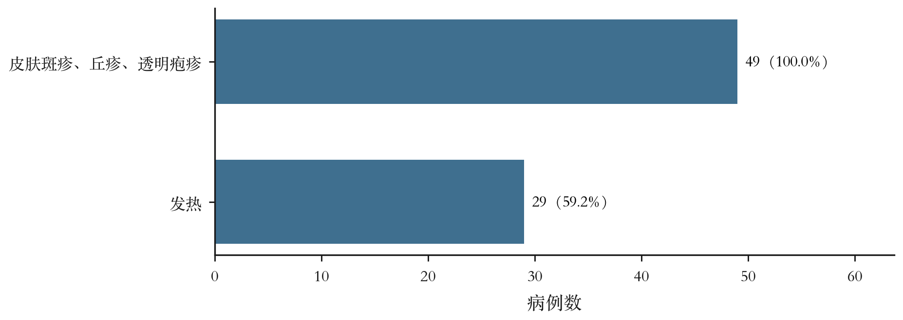
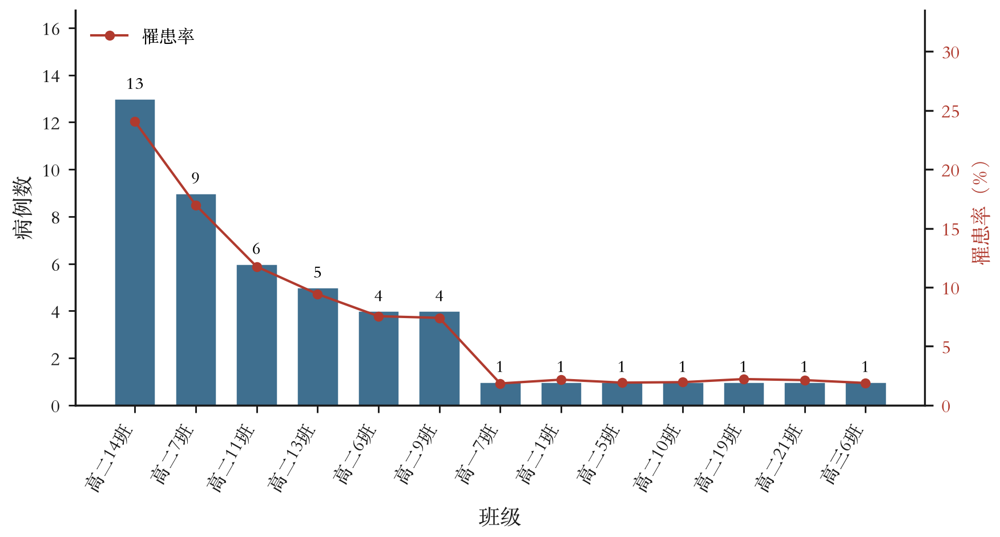

# 关于某高级中学一起水痘暴发疫情的结案调查报告

经采取综合防控措施，最后一例病例有效隔离后经过1个最长潜伏期（21天）无新发病例，所有病例均已痊愈，本次疫情已得到有效控制，达到结案标准。现将调查处理情况报告如下：

## 一、基本情况

某高级中学，位于惠山区某镇新兴东路96号，共有60个班级，学生3105人（男1687人、女1418人），其中住宿生1562人；教职工303人；全校共3408人。全校3个年级60个班级（高一21个、高二21个、高三18个）；设学生宿舍与食堂，住宿生1562人。学校平面图见附件2。

## 二、调查方法

### （一）病例定义
1.临床诊断病例：2026年3月5日开学起某高级中学学生和教职员工中，有皮肤斑疹、丘疹、透明疱疹并有出疹部位剧烈瘙痒者，伴或不伴有发热；或临床表现不典型，但具有流行病学史（发病前21天内在无有效个人防护的情况下与水痘或带状疱疹患者有密切接触）。
2.确诊病例：临床诊断病例，具有以下任一项者：（1）水痘核酸检测阳性；（2）水痘抗原检测阳性；（3）水痘病毒培养分离阳性；（4）VZV-IgM阳性（排除近期接种水痘减毒活疫苗）；（5）VZV-IgG阳转或恢复期较急性期滴度呈4倍及以上升高。

### （二）病例搜索方法
1.现场检查疫情发生班级学生及教职员工有无皮肤斑疹、丘疹、透明疱疹，指导学校规范开展晨、午、晚检；
2.查阅惠山区辖区医疗机构门诊、住院一览表；
3.查阅中国疾病预防控制信息系统中网络直报水痘病例；
4.查阅某高级中学传染病登记一览表和因病缺课缺勤登记表。
对搜索到的病例逐一开展流行病学个案调查，内容包括基本信息、发病及就诊信息、实验室检测信息。

## 三、疫情概况

### （一）发病概况
本次疫情自2026年3月11日首例病例发病开始，至2026年5月31日末例病例发病，累计报告水痘病例49例，其中临床诊断49例、实验室确诊0例，罹患率1.44%（49/3408）。

### （二）临床特征
49例病例中，皮肤斑疹、丘疹、透明疱疹49例（100.00%），发热29例（59.18%）。所有病例均为轻症，无重症及死亡病例。

## 四、流行病学特征

### （一）首发病例
彭某，男，17岁，某高级中学高二7班学生，现住址为惠山区某镇某社区某村，联系电话（略）。该学生于3月11日出现发热（热峰38℃）和腰背部疱疹症状。调查该生无水痘疫苗接种史，自述发病前3周内无外出史，无水痘病例接触史。

### （二）时间分布
本次疫情首例病例于2026年3月11日发病，末例病例于2026年5月31日发病。（本报告依据汇总数据撰写，未取得逐例发病日期明细，故未绘制流行曲线。）

### （三）班级（地区）分布
48例病例分布于13个班级（单元），其余1例未归入具体班级（如教职员工），其中高二14班13例（罹患率24.07%），高二7班9例（罹患率16.98%），高二11班6例（罹患率11.76%），其余班级发病数均在5例及以下。

| 班级（单元） | 病例数 | 人数 | 罹患率（%） |
|---|---|---|---|
| 高二14班 | 13 | 54 | 24.07 |
| 高二7班 | 9 | 53 | 16.98 |
| 高二11班 | 6 | 51 | 11.76 |
| 高二13班 | 5 | 53 | 9.43 |
| 高二6班 | 4 | 53 | 7.55 |
| 高二9班 | 4 | 54 | 7.41 |
| 高一7班 | 1 | 54 | 1.85 |
| 高二1班 | 1 | 46 | 2.17 |
| 高二5班 | 1 | 52 | 1.92 |
| 高二10班 | 1 | 51 | 1.96 |
| 高二19班 | 1 | 45 | 2.22 |
| 高二21班 | 1 | 47 | 2.13 |
| 高三6班 | 1 | 53 | 1.89 |
| 合计 | 48 | 666 | 7.21 |

### （四）人群分布
共49例病例，其中男性36例、女性13例，男女性别比2.77:1。病例以高二年级学生为主（46例），高一年级与高三年级各1例。

### （五）流行病学史
对发病学生进行流行病学调查发现：除首发病例外，其余病例均有水痘病例接触史（同班、同宿舍、同食堂），所有病例均经医疗机构诊断为水痘。

## 五、实验室检测
此次疫情未采集病例标本进行水痘-带状疱疹病毒核酸检测，病例诊断依据临床表现与流行病学史。

## 六、病因假设和风险研判
根据流行病学分布特征、临床症状与实验室检测情况，判定本次疫情为一起学校水痘暴发疫情。主要原因是水痘为呼吸道传染病，也可通过接触传播，学校学生及教职员工人群密集，在教室、宿舍、走廊、卫生间等场所密切接触多，容易造成传播。

## 七、控制措施及效果评价

### （一）某高级中学落实的预防控制措施
1. 严格落实病例管理及复课。学校每日开展晨午晚检，落实因病缺课缺勤病因追查；出现发热、皮疹等疑似症状者及时隔离离校、就诊并居家隔离治疗，至疱疹全部干燥结痂（不少于发病后14天），持社区卫生服务中心复工/复课证明方可返校，复课由校医统一归口管理。
2. 追踪水痘疫情趋势变化。每日零报告，掌握当日新发、累计报告、当日痊愈、累计痊愈病例数，分班级统计并逐级上报至惠山区疾控中心。
3. 做好水痘疫苗宣传和应急接种。对涉疫班级、涉疫宿舍及关联宿舍中符合条件的学生开展应急接种，在某镇卫生院安排专场。截至2026年5月26日，应种678人、实种139人，应急接种率20.50%。
4. 强化校内环境卫生。指导学校做好教室、宿舍、厕所、食堂等公共场所消毒通风，提高频次并做好记录；本次疫情消毒面积约8万平方米。
5. 开展健康宣教。向学生、家长、教职工宣传校园常见传染病防治知识，做好患病学生及家长的解释沟通与心理疏导，关注舆情。
6. 疫情期间不组织大型聚集性活动，建议涉疫班级送餐至教室或错峰用餐、错峰上下学。

### （二）疾控与医疗机构落实的措施
惠山区疾控中心接报当日即赴现场调查处置，指导学校落实病例隔离、晨午晚检、消毒通风与应急接种；无锡市疾控中心、惠山区疾控中心和某镇卫生院多次赴学校现场开展调查处置并提出防控措施；辖区医疗机构严格执行预检分诊，社区卫生服务站不得截留水痘病例，某镇卫生院每日零报告并逐级上报。

### （三）效果评价
采取上述措施后，疫情于4月下旬起明显回落，5月19日至5月31日仅发病3例，末例病例（5月31日）有效隔离后经一个最长潜伏期（21天）观察，全校无新发病例，疫情得到有效控制。

## 八、存在问题、经验总结和建议
此次疫情处置中某镇卫生院介入较及时，出现新发水痘病例即赴学校调查处置；4月20日网报后市、区、镇三级多次赴现场处置。疫情出现多代病例的原因：一是水痘为呼吸道传染病，亦可通过接触传播，传播途径难以切断；二是应急接种率较低，未形成有效免疫屏障；三是因考虑学业，个别病例数较多的班级未采取停课措施；四是晨、午晚检质量不高，可能存在带病上课情况。

1.水痘高发期，学校应重点做好教室、宿舍、食堂等场所通风，规范开展病例监测，严格落实晨午晚检，加强因病缺勤管理，加大防控知识宣传力度，配合接种单位适时开展应急接种，提高接种率。
2.密切关注学校、托幼机构等重点场所水痘疫情，要求辖区各社区卫生服务中心发现暴发苗头立即赴现场调查处置，避免暴发疫情发生。
3.卫生部门与教育部门积极合作，共同落实预防控制措施，有效防止疫情进一步暴发流行。

## 九、经济损失及成本效益分析
本起疫情共造成经济损失42,410元，其中直接经济损失32,610元，间接经济损失9,800元。直接经济损失构成：患者诊疗费18,000元、陪护误工费9,600元、疫情处理材料及设备损耗5,010元、其他0元。经测算，通过及时处置避免3359人发病，效益约2,907,249元。

## 十、结案
鉴于距离最后一例病例有效隔离后经过一个最长潜伏期（21天）无新发病例，且所有病例均已痊愈复课，经区专家组讨论，该起疫情可结案。

---

## 附录 A　待补充信息清单

> 本报告所需字段已齐备（完成度 83.7%），无待补充项。

**分级统计**：P0 3 项、P1 0 项、P2 5 项。

> 报告单位：无锡市惠山区疾病预防控制中心　报告人：（略）　审核人：（略）
> 联系电话：（略）　报告时间：2026年6月24日13时00分