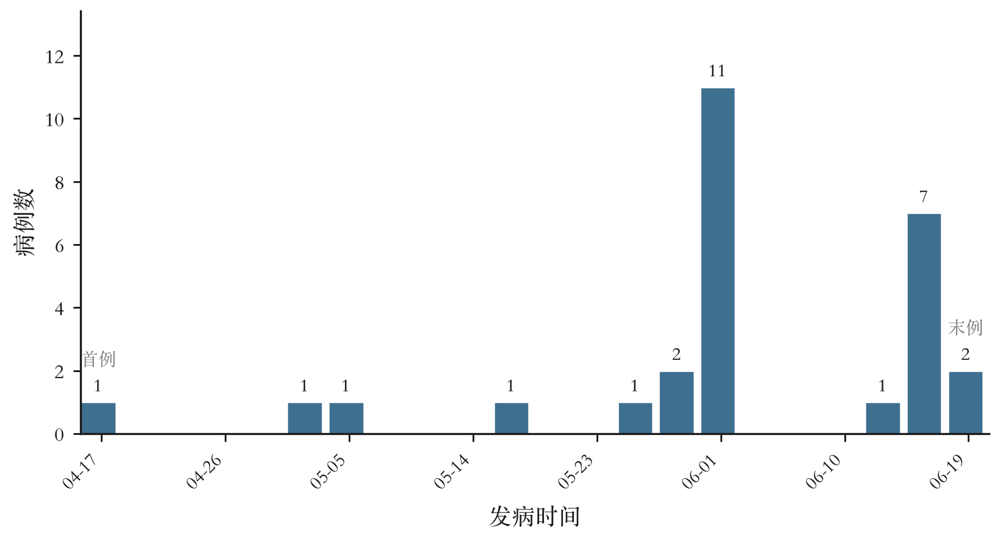
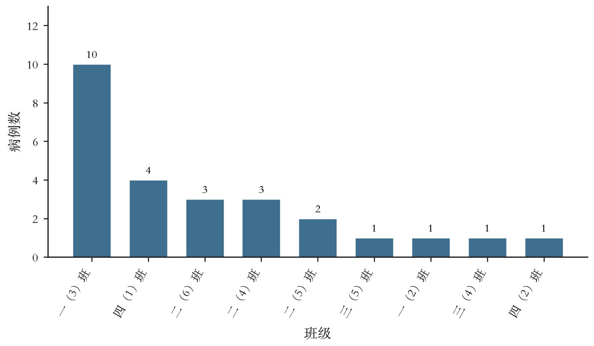
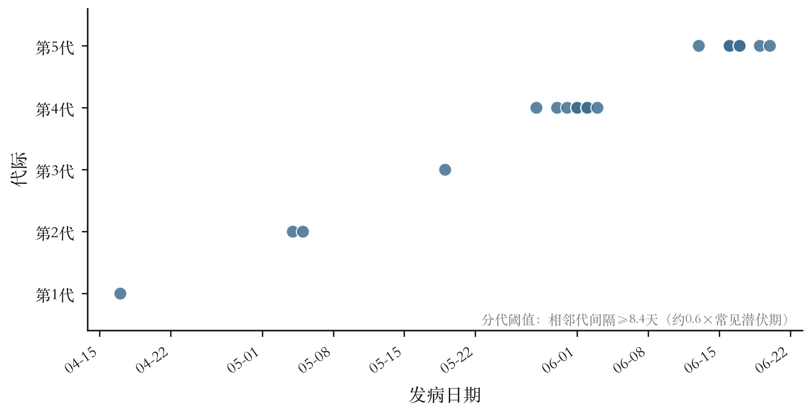

# 关于无锡市梁溪区某街道某实验学校一起水痘暴发疫情的初步调查报告

〔待补P0-1〕。接报后，我中心立即组织专业人员赶赴某实验学校开展现场流行病学调查、病例搜索、样品采集与防控措施指导。截至2016年6月3日，共报告水痘病例28例。现将初步调查情况报告如下：

## 一、基本情况

某实验学校，位于梁溪区某路，共有班级48个，1900名学生，教职员工145名。学校设9个年级48个班级，教职员工145名，学生1900余名，多数为本地籍学生；校医由会计兼任，学校卫生状况良好，通风情况较好。

## 二、疫情概况

### （一）病例定义
临床诊断病例：<机构>学生及教职员工中皮肤斑疹、丘疹、透明疱疹并有出疹部位瘙痒者，伴或不伴发热；或临床表现不典型但发病前21天内有水痘/带状疱疹病例密切接触史

### （二）病例搜索
通过查阅某实验学校晨午检与因病缺勤登记、访谈校医及班级教师、查阅辖区医疗机构门诊与住院记录、检索中国疾病预防控制信息系统网络直报病例等方式开展病例搜索。

### （三）发病概况
截至2016年6月3日，共报告水痘病例28例（临床诊断28例、实验室确诊0例），罹患率1.37%（28/2045）。
〔待补P1-1〕

## 三、流行病学调查

### （一）首发病例
〔待补P1-2〕

### （二）时间分布
本次疫情自2016-04-17首例发病，至2016-06-20末例发病，历时65天，共28例。流行曲线以72天为间隔绘制，发病高峰出现在06月01日（11例）。按发病时间推算，本次疫情已出现5代病例，各代高峰间隔接近一个常见潜伏期。

### （三）班级（单位）分布
26例病例分布于9个班级（单元），另有2例班级信息不详，其中一（3）班10例，四（1）班4例，二（6）班3例，其余班级发病数均在5例及以下。

| 班级（单元） | 病例数 | 人数 | 罹患率（%） |
|---|---|---|---|
| 一（3）班 | 10 | — | — |
| 四（1）班 | 4 | — | — |
| 二（6）班 | 3 | — | — |
| 二（4）班 | 3 | — | — |
| 二（5）班 | 2 | — | — |
| 不详 | 2 | — | — |
| 三（5）班 | 1 | — | — |
| 一（2）班 | 1 | — | — |
| 三（4）班 | 1 | — | — |
| 四（2）班 | 1 | — | — |
| 合计 | 28 | — | — |

### （四）人群分布
28例病例中，男性15例、女性13例，男女性别比1.15:1；年龄以5岁组为主。

### （五）流行病学史
〔待补P1-3〕

## 四、实验室检测
〔待补P0-2〕

## 五、调查判断

结合流行病学分布特征、临床表现及实验室检测结果，综合判断本次疫情为一起某实验学校水痘暴发疫情，达到突发公共卫生事件未分级报告标准，已于—在网络直报系统报告。
风险研判：该病最长潜伏期21天，末例发病后仍需观察至满一个潜伏期；集体单位人群密集、接触频繁，若晨检与缺勤追踪落实不到位，存在后续续发病例风险；暴发判定标准为1周内同一集体单位≥10例（或出现重症/死亡）。〔待补P1-4〕。

## 六、已采取的预防控制措施
〔待补P0-3〕

## 七、下一步工作
1. 继续落实晨午检与因病缺勤病因追查，每日零报告至末例病例后一个最长潜伏期
2. 加强教室、宿舍、食堂等场所通风与预防性消毒，做好记录
3. 针对同班/同宿舍/同餐桌接触等关键环节开展专项排查
4. 在知情同意、自愿自费原则下推进应急接种，提高免疫屏障覆盖率
5. 持续开展健康教育，告知家长与教职工早期症状识别与及时就诊要求

---

## 附录 A　待补充信息清单

> 本报告当前完成度 **38.9%**（仅为框架稿，需现场数据支撑）。正文中以〔待补N〕标记的位置，对应该清单编号。按 **P0 → P1 → P2** 顺序补齐；同一等级内按权重降序，即越靠前越影响结论成立。

| 编号 | 等级 | 待补充内容 | 建议时限 |
|---|---|---|---|
| 〔待补P0-1〕 | P0 | 接报时间、报告人与报告途径 | 24小时内 |
| 〔待补P0-2〕 | P0 | 实验室检测结果（标本类型、份数、阳性数、检测方法） | 24小时内 |
| 〔待补P0-3〕 | P0 | 已落实的预防控制措施（传染源管理、切断传播途径、保护易感者、健康宣教、督导） | 24小时内 |
| 〔待补P1-1〕 | P1 | 病例症状构成（各症状例数与占比） | 48小时内 |
| 〔待补P1-2〕 | P1 | 首例病例姓名、性别、年龄、班级、住址、发病与就诊经过、疫苗接种史 | 48小时内 |
| 〔待补P1-3〕 | P1 | 病例发病前最长潜伏期内的接触史、共同暴露因素（同班/同宿舍/共同就餐/共同水源等） | 48小时内 |
| 〔待补P1-4〕 | P1 | 风险等级评估与是否建议升级应急响应 | 48小时内 |
| 〔待补P1-5〕 | P1 | 审核人 | 48小时内 |
| 〔待补P1-6〕 | P1 | 联系电话 | 48小时内 |

**等级含义**
- **P0（阻断性）**：不补齐则疫情性质判定、事件分级、网络直报或结案不成立，存在被上级退回或问责风险。
- **P1（结构性）**：不影响结论，但章节缺内容，影响报告完整性与评审印象。
- **P2（精细化）**：提升可信度与说服力，可在结案前一并完善。

**分级统计**：P0 7 项、P1 4 项、P2 6 项。

> 报告单位：无锡市梁溪区疾病预防控制中心　报告人：待填　审核人：〔待补P1-5〕
> 联系电话：〔待补P1-6〕　报告时间：2026年11月18日14时42分